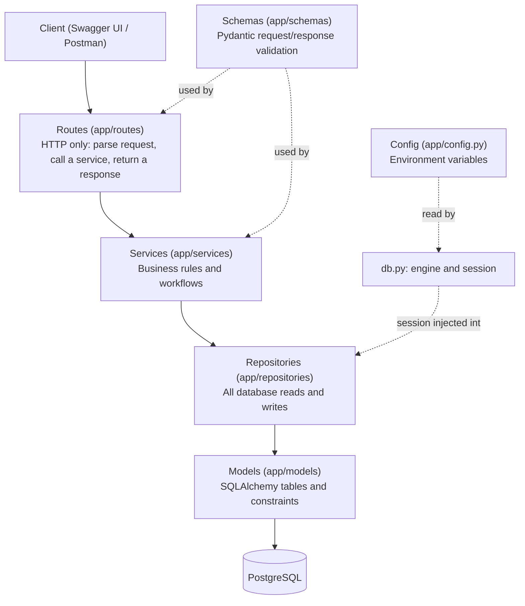
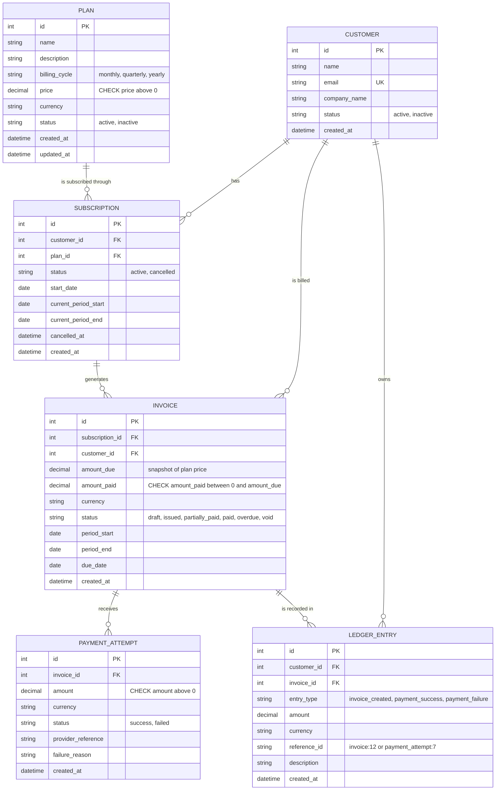
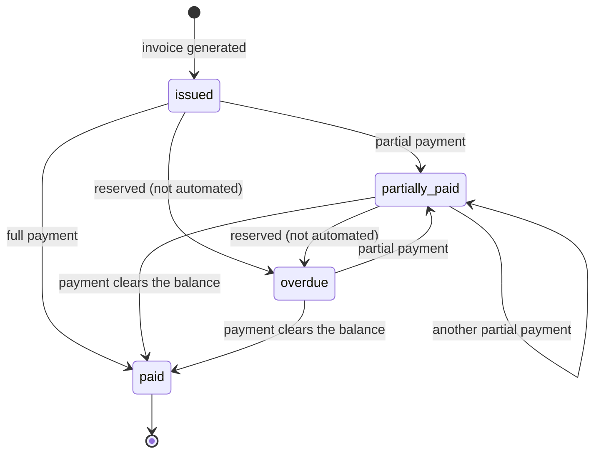

# SubLedger - Low-Level Design

This document is the design that the code follows. It covers the architecture, the data model, who owns each responsibility and each business rule, the design pattern used, and the two core flows.

## 1. Scope

SubLedger is a simplified billing backend: plans, customers, subscriptions, invoices, payment attempts and an append-only ledger.

Out of scope, as in the brief: a real payment gateway, a frontend, taxation, proration, and authentication / RBAC.

## 2. Architecture

The code is split into layers. A layer may only call the layer directly below it.

| Layer | Folder | Responsibility | Must not |
|---|---|---|---|
| Routes | `app/routes/` | Map HTTP to a service call; set status codes | Contain business rules or SQL |
| Schemas | `app/schemas/` | Validate request shape and format responses | Query the database |
| Services | `app/services/` | Enforce business rules; orchestrate repositories | Import FastAPI or write SQL |
| Repositories | `app/repositories/` | Read and write the database | Decide business rules |
| Models | `app/models/` | Describe tables, relationships and constraints | Contain workflows |
| Config / DB | `app/config.py`, `app/db.py` | Environment settings, engine, session | Contain domain logic |
| Wiring | `app/dependencies.py` | Build repositories and services and inject the session | Contain domain logic |

## 3. Entity relationship diagram

### Fields added beyond the brief's minimum, and why

| Field | Why |
|---|---|
| `Subscription.created_at` | Standard audit field. |
| `LedgerEntry.currency` | An amount without a currency is ambiguous once plans can use different currencies. |
| `Invoice` CHECK constraints | The database refuses an invoice whose `amount_paid` is negative or larger than `amount_due`, even if application code has a bug. |
| `Invoice.amount_remaining` (computed, not stored) | Always equals `amount_due - amount_paid`; storing it would create a second value that could drift. |

Money is stored as `NUMERIC(10, 2)` and handled as `Decimal` in Python, never as `float`.

## 4. Service responsibility table

Each service receives its collaborators through its constructor (dependency injection).

| Service | Owns | Must not do | Depends on |
|---|---|---|---|
| `PlanService` | Price must be greater than 0; creating and updating plans; activating / deactivating a plan | Touch subscriptions or invoices | `PlanRepository` |
| `CustomerService` | Creating customers; email uniqueness (case-insensitive); customer lookup | Create ledger entries | `CustomerRepository` |
| `SubscriptionService` | Creating and cancelling subscriptions; rejecting inactive plans; rejecting a duplicate active subscription to the same plan; computing the billing period | Generate invoices | `SubscriptionRepository`, `PlanRepository`, `CustomerRepository` |
| `InvoiceService` | Generating invoices; snapshotting `amount_due` from the plan price; moving invoice status to `partially_paid` / `paid` after a payment | Record payment attempts | `SubscriptionRepository`, `PlanRepository`, `InvoiceRepository`, `LedgerService` |
| `PaymentService` | Recording payment attempts; validating amount, currency and invoice state; triggering the invoice update and ledger entry | Decide how an invoice's status changes (that is `InvoiceService`) | `InvoiceRepository`, `PaymentAttemptRepository`, `LedgerService`, `InvoiceService` |
| `LedgerService` | Creating append-only ledger entries; building `reference_id`; reading a customer's ledger history | Commit a transaction, or update / delete an entry | `LedgerRepository`, `CustomerRepository` |

`PaymentService` takes `InvoiceService` as an extra dependency compared with the brief's skeleton. This is deliberate: the brief says `InvoiceService` owns "update invoice status after payment" and `PaymentService` only "triggers" it, so `PaymentService` has to be able to call it.

## 5. Repository responsibility table

| Repository | Reads / writes | Common methods |
|---|---|---|
| `PlanRepository` | `plans` | `add`, `save`, `get_by_id`, `list(status)` |
| `CustomerRepository` | `customers` | `add`, `get_by_id`, `get_by_email`, `list` |
| `SubscriptionRepository` | `subscriptions` | `add`, `save`, `get_by_id`, `get_active_for_customer_and_plan`, `list(customer_id, status)` |
| `InvoiceRepository` | `invoices` | `add`, `save`, `get_by_id`, `get_by_id_for_update` (row lock) |
| `PaymentAttemptRepository` | `payment_attempts` | `add`, `list_for_invoice` |
| `LedgerRepository` | `ledger_entries` | `add`, `list_for_customer`, `list_for_invoice`. `save` raises, so there is no update path |

All repositories extend `BaseRepository`, which provides `add`, `save`, `commit` and `rollback`. Repositories only flush; the calling service commits once (see section 8).

## 6. Business rule ownership

| # | Rule | Schema | Service | Repository | Database |
|---|---|---|---|---|---|
| 1 | Plan price must be greater than 0 | `PlanCreate` / `PlanUpdate` (`gt=0`) | `PlanService` | | `CHECK price > 0` |
| 2 | Customer email must be unique | `EmailStr` (format) | `CustomerService` (case-insensitive pre-check) | `CustomerRepository.get_by_email` | `UNIQUE (email)` |
| 3 | A subscription cannot be created for an inactive plan | | `SubscriptionService` | | |
| 4 | No two active subscriptions to the same plan per customer | | `SubscriptionService` | `SubscriptionRepository.get_active_for_customer_and_plan` | Partial unique index on `(customer_id, plan_id)` where `status = 'active'` |
| 5 | Invoice `amount_due` comes from the plan price at generation time | | `InvoiceService.generate_invoice` | | `amount_due` is stored on the invoice, so later price changes do not alter it |
| 6 | A successful payment cannot exceed the remaining unpaid amount | `amount` must be greater than 0 | `PaymentService` (plus a re-check in `InvoiceService`) | `InvoiceRepository.get_by_id_for_update` (row lock) | `CHECK amount_paid <= amount_due` |
| 7 | Fully paid becomes `paid`; partial payment becomes `partially_paid` | | `InvoiceService.apply_successful_payment` | | |
| 8 | A failed payment does not increase `amount_paid` | | `PaymentService` (failed branch never calls `InvoiceService`) | | |
| 9 | Ledger entries are append-only and traceable through `reference_id` | `LedgerEntryResponse` | `LedgerService` (create and read only) | `LedgerRepository` (no update / delete; `save` raises) | ORM `before_update` / `before_delete` hooks raise `AppendOnlyError`; `reference_id` is non-null and indexed |

Other rules I added:

| Rule | Owner |
|---|---|
| Invoices can only be generated for active subscriptions | `InvoiceService` |
| Payment currency must match the invoice currency | `PaymentService` |
| Only `issued`, `partially_paid` and `overdue` invoices accept payments | `PaymentService` |
| A cancelled subscription cannot be cancelled again | `SubscriptionService` |
| A billing period must have both dates, with the end after the start | `InvoiceGenerate` schema |

## 7. Design pattern: Repository pattern with a Service layer

**What it is.** A repository is the only place that knows how to query the database. A service holds the business rules and calls repositories. The route only translates HTTP into a service call.

**Why it fits SubLedger.**

- The brief's rules (no overpayment, one active subscription per plan, append-only ledger) are business logic. Keeping them in services means they are written once and not scattered across route functions.
- Services receive their repositories through the constructor, so they can be tested with fake repositories and no database. `tests/test_services_unit.py` does exactly this.
- Swapping or changing storage touches only the repositories.
- Each class has one reason to change, which keeps the code easy to read and extend.

**Trade-off.** More files and some indirection compared with writing queries in the routes. For a billing system where correctness matters more than brevity, that is worth it.

### How the SOLID principles show up

| Principle | Where |
|---|---|
| Single responsibility | Each service owns one area; each repository one table; routes only do HTTP |
| Open / closed | New entry types or payment statuses are added without changing routing or repositories |
| Liskov substitution | Any object with the repository's methods (for example a mock) can replace a real repository in a service |
| Interface segregation | Each service depends only on the repositories it uses, not on one large data-access class |
| Dependency inversion | Services depend on injected collaborators and raise domain errors, not `HTTPException`; `main.py` maps them to HTTP |

## 8. Dependency injection and transactions

`app/dependencies.py` builds every repository and service with FastAPI's `Depends`. `get_db` is resolved once per request, so every repository in that request shares one session and therefore one transaction.

**Transaction rule:** repositories flush, services commit. A service performs all its writes, then commits once at the end. If it raises first (a business-rule error), nothing is committed and the session is discarded. This is what makes these operations all-or-nothing:

- Invoice generation: the invoice and its `invoice_created` ledger entry.
- Payment recording: the payment attempt, the invoice update and the ledger entry.

`BaseRepository` converts a database `IntegrityError` (for example a unique-index violation in a race) into a `ConflictError`, which becomes an HTTP 409.

## 9. Core flows

### Invoice generation (`POST /invoices/generate`)

1. The route validates the body (`subscription_id`, optional `period_start` and `period_end`).
2. `InvoiceService` loads the subscription through `SubscriptionRepository`; unknown id gives 404.
3. It verifies the subscription is active; otherwise 409.
4. It loads the plan through `PlanRepository` and reads the plan's current price and currency.
5. It picks the billing period: the supplied one, or the subscription's current period.
6. It calculates `due_date` as `period_start + INVOICE_DUE_DAYS` (default 14).
7. `InvoiceRepository` creates the invoice with `amount_due` set to the plan price and status `issued`.
8. `LedgerService` adds an `invoice_created` entry with `reference_id = invoice:<id>`.
9. The service commits once, so the invoice and ledger entry are saved together.
10. The route returns the invoice (201), including `amount_remaining`.

### Payment recording (`POST /payments/record`)

1. The route validates the body (`invoice_id`, `amount` greater than 0, `currency`, `status`, `provider_reference`, optional `failure_reason`).
2. `PaymentService` fetches the invoice through `InvoiceRepository.get_by_id_for_update`, which locks the row; unknown id gives 404.
3. It checks the invoice is payable (`issued`, `partially_paid` or `overdue`); otherwise 409.
4. It checks the payment currency matches the invoice; otherwise 422.
5. If the payment succeeded, it checks the amount does not exceed `amount_remaining`; otherwise 422.
6. `PaymentAttemptRepository` creates the attempt. For a failed payment a `failure_reason` is stored (a default text if none was sent).
7. On success, `InvoiceService.apply_successful_payment` adds the amount to `amount_paid` and sets the status to `paid` or `partially_paid`, and `LedgerService` adds a `payment_success` entry (`reference_id = payment_attempt:<id>`).
8. On failure, `amount_paid` and the invoice status are left untouched, and `LedgerService` adds a `payment_failure` entry.
9. The service commits once: attempt, invoice update and ledger entry together.
10. The route returns the payment attempt, the invoice status and the updated invoice (201).

### Status lifecycles

`draft` and `void` exist as valid statuses but nothing in the base version moves an invoice into them, and neither accepts payments.

Subscriptions go `active` to `cancelled` only. Plans toggle between `active` and `inactive`.

## 10. Error handling

Services raise domain errors; `app/main.py` maps them to responses of the form `{"error": "<code>", "detail": "<message>"}`.

| Error | HTTP | Used for |
|---|---|---|
| `NotFoundError` | 404 | Unknown plan, customer, subscription or invoice |
| `ConflictError` | 409 | Duplicate email, duplicate active subscription, inactive plan, cancelled subscription, invoice not payable |
| `BusinessRuleError` | 422 | Overpayment, currency mismatch, invalid price |
| `AppendOnlyError` | 409 | Attempt to modify or delete a ledger entry |
| Pydantic validation | 422 | Malformed body, price not greater than 0, bad period |

## 11. Concurrency

- **Payments:** `get_by_id_for_update` issues `SELECT ... FOR UPDATE`. Concurrent payments for one invoice are processed one at a time, so two payments cannot both pass the remaining-balance check.
- **Subscriptions:** the partial unique index makes the database reject a second active subscription even if two requests pass the service check at the same moment.
- These were verified against a real PostgreSQL instance (5 simultaneous full payments produced exactly one success; 6 simultaneous subscription requests produced exactly one 201). The automated test suite runs on SQLite, which ignores row locks, so it covers the rules but not the locking.

## 12. Assumptions

1. Creating a subscription also activates it. There is no separate pending state in the base version.
2. A subscription's first period starts on `start_date` (default today) and ends one month, one quarter or one year later, clamped to the last day of the month.
3. `due_date` is `period_start` plus `INVOICE_DUE_DAYS`.
4. A failed payment is recorded even if its amount exceeds the remaining balance, because it changes nothing; the balance rule applies to successful payments.
5. `reference_id` is a readable string of the form `invoice:<id>` or `payment_attempt:<id>`.
6. Ledger amounts are always positive; the `entry_type` gives the direction.
7. Currency is a 3-letter code, upper-cased, defaulting to `USD`.
8. Customer email is stored lower-cased.
